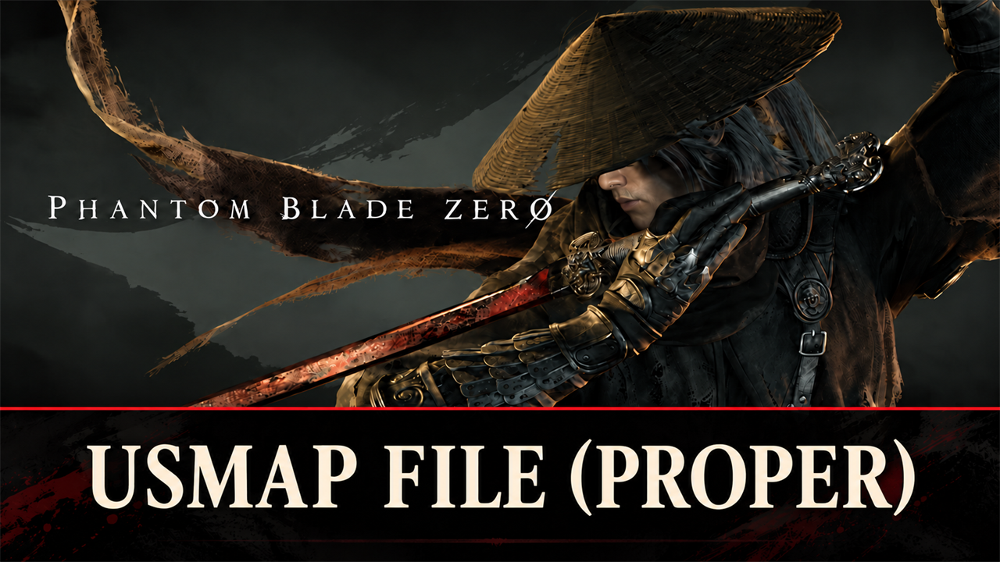

# USMAP File (Proper)

A full mapping file (`.usmap`) for Phantom Blade Zero, for modders: every native type plus every Blueprint class,
struct and enum of the game's packages.

## What it is

- Modding tools such as FModel and UAssetGUI need a mapping file to read this game's assets. The game saves asset
  values without their names (unversioned properties); the mapping file gives each value its name and type.
- This file holds all of them: 30,471 structs and classes (14,639 of them Blueprint classes) and 3,247 enums, with
  the package path of each type (PPTH) and the flags (EATR), in the format UE4SS writes.
- The Blueprint types come from the game's packages, so the file holds every one of them, not only the ones that
  are loaded at some moment in the game: all 3,034 `BP_` Blueprint classes (the one other `BP_` package holds data,
  not a class), 5,781 `GA_` abilities (the other `GA_` packages we looked at hold bullet data or animations), all
  208 Animation Blueprints.

## Screenshots

## How to use

- **FModel:** in the settings, turn on the local mapping file and choose `ProjectPBZ-5.7.4-301524-full.usmap`.
- **UAssetGUI:** copy the file into `%LOCALAPPDATA%\UAssetGUI\Mappings\` and choose
  `ProjectPBZ-5.7.4-301524-full` in the mappings list. UAssetGUI 1.1.0 knows UE 5.6 at most: use `VER_UE5_6` for
  this UE 5.7.4 game.
- Other tools that take a `.usmap` (CUE4Parse and the tools built on it) work the same way.

## Measured

- **UAssetGUI 1.1.0** (one run at a time), 425 game assets (all data tables of `Content/PBZContent/DataTable/` and
  the item Blueprints of `PBZContent/Blueprint/Item/`), 2,914 exports: 416 assets fully read, 77 of 78 data tables
  read. The 9 exports left are 8 spline components and one editor table, which UAssetGUI 1.1.0 does not read.
- **CUE4Parse** (the library of FModel): 32,510 exports of 1,747 gameplay packages read with no error.

## How it was made

1. **Native types:** read from the running game, read-only, by `src/usmap_live.py --native-only`, with the same
   objects, types and rules as UE4SS's mapping generator. UE4SS's own dump with Blueprint types crashes this game
   ([UE4SS-RE/RE-UE4SS#1483](https://github.com/UE4SS-RE/RE-UE4SS/issues/1483)).
2. **Blueprint types:** read from all 252,284 packages of the game with [CUE4Parse](https://github.com/FabianFG/CUE4Parse)
   (`src/usmap_offline/`, 34 seconds, no error), turned into usmap types by UE4SS's rules (`src/usmap_offline.py`).
   Checked against the running game (`src/usmap_live.py`) on the 2,380 Blueprint types that were loaded: 2,300
   equal, 76 different only in the upper or lower case of a name (Unreal ignores it), 4 in an enum that the game
   does not have (Known issues).
3. **Merged** into one file with every name once (`src/usmap_merge.py`), and measured (`src/usmap_quality.py`).

## Compatibility

- Game version: Release (Steam build 26266538) (`CL-301524_JKS-17219`), Unreal Engine 5.7.4.
- After a game update the file can be out of date for the types the update changes. A new version follows; this
  page names the game version it was made for.

## Known issues

- A mapping file holds each type name once. 32 names exist in several packages with different content (for
  example `AnimBlueprintGeneratedConstantData` of each Animation Blueprint, or two copies of the Ultra Dynamic Sky
  plugin): the file keeps the native type, else the most common one. FModel reads such types from the asset itself.
- 10 enum properties (in AI conditions such as `Condition_Distance_C`) point to the enum `EComparisonMethod`, which
  the game does not have. The file gives them their number type (`Byte`), which reads the same data.
- One property (`BPDA_SeqConfigData_C.ActorCollectDatas`) points to a struct that is missing in the game; its struct
  name is `None`. One editor-only widget (`WBP_DefaultQuestNode_C`, its parent class exists only in the editor) is
  left out.

## How to build

Anyone can make this file again from the game and check it against the download. `README.md` has the details.

1. Windows with PowerShell 5.1, Python 3.11 or newer, the [.NET 10 SDK](https://dotnet.microsoft.com/download), and
   `oo2core_9_win64.dll` (Oodle, for example from the [retoc](https://github.com/trumank/retoc/releases) release).
2. The game, its AES key, and a mapping file of its native types (`src/usmap_live.py --native-only` while the game
   runs, or UE4SS's Ctrl+Num6 with `DumpUSMAP(false)`).
3. `powershell -ExecutionPolicy Bypass -File .\build.ps1 -PaksDir <game>\ProjectPBZ\Content\Paks -AesKey <key> -Native <native.usmap> -Oodle <oo2core_9_win64.dll>`
4. The file: `dist\ProjectPBZ-5.7.4-301524-full.usmap`, and `dist\SHA256SUMS.txt`.

## Credits

- Made by Kintaro. MIT license: you may use, change and share the file and the code.
- [CUE4Parse](https://github.com/FabianFG/CUE4Parse) by FabianFG and its contributors (Apache-2.0) reads the packages.
- The format and its rules follow the mapping generator of [UE4SS](https://github.com/UE4SS-RE/RE-UE4SS) (MIT), a
  port of OutTheShade's UnrealMappingsDumper.
- Phantom Blade Zero and its files belong to S-GAME. The file holds only the names and layouts of the game's types.
